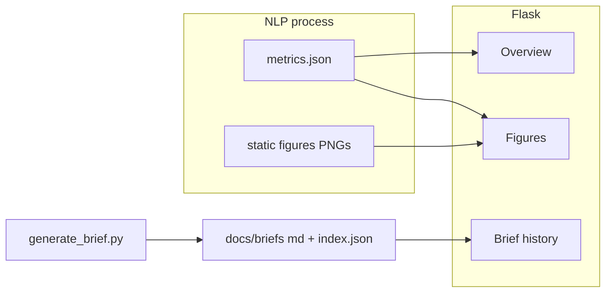

# 多页 Dashboard、加权情感图与简报历史

## 数据与公式（已实现口径）

- **权重**（每条有效笔记一行）：`w = 1 + log(1+likes) + 2*log(1+collects) + 1.5*log(1+comments_count)`，其中 `likes` / `collects` / `comments_count` 来自 [`src/nlp/process.py`](e:\Project4\jd_drissionpage_new\src\nlp\process.py) 处理时的 `valid_df`行；无法解析或非数字按 **0**。
- **加权分布**：对 `sentiment_coarse` 三类分别 **sum(w)**，再换算为与现有一致的占比（或同时在 `metrics.json` 中保留 raw 加权和与 `*_pct` 便于核对）。
- **`metrics.json` 新增字段**（每轨）：例如 `sentiment_distribution_weighted`（结构与 `sentiment_distribution` 对齐，值为加权后的相对比例或并列存 `weighted_mass`），并在 [`docs/DATA_SCHEMA.md`](e:\Project4\jd_drissionpage_new\docs\DATA_SCHEMA.md) 的 processed/metrics 小节补一行说明。

## 1. NLP：加权聚合 + 静态对比图

**文件：** [`src/nlp/process.py`](e:\Project4\jd_drissionpage_new\src\nlp\process.py)

- 在已有 `valid_df["sentiment_coarse"]` 之后：解析数值列（与现有 `RAW_MAIN_FIELDS` 一致），计算 `weight`，按类求和，写入 `metrics` 字典。
- 复用已有 matplotlib `Agg` 与 `_export_wordcloud_png` 的模式，新增 **`_export_sentiment_compare_png(track, unweighted_dist, weighted_dist, root)`**：
  - 单张 PNG **左右两个子图**（与 notebook 条形风格一致：同类颜色 `#e57373` / `#90a4ae` / `#81c784`），左「coarse count」、右「weighted」。
  - 输出路径：**`app/static/figures/sentiment_compare_{track}.png`**（与现有 [`app/templates/dashboard.html`](e:\Project4\jd_drissionpage_new\app\templates\dashboard.html) 中 wordcloud 路径约定一致）。
- 若某轨 `error` /无有效行，跳过图或生成占位逻辑与 wordcloud 一致（保持简单）。

## 2. Flask：多路由、侧栏、共享布局

**文件：** [`app/__init__.py`](e:\Project4\jd_drissionpage_new\app\__init__.py)、新建 **`app/templates/base.html`**（侧栏 + ``）、拆分/重写页面模板。

| 路由 | 模板 | 行为 |
|------|------|------|
| `GET /` | `overview.html` | 当前 dashboard 指标区，**轨列表由 `metrics.json` 的 key 动态生成** |
| `GET /figures` | `figures.html` | 仅图：每轨 `sentiment_compare_*.png` + `wordcloud_*.png` |
| `GET /brief` | `brief.html` | 历史列表 + 正文区 |
| `GET /brief/<brief_id>` | 同上或专用 partial | 可选：深链打开某条；或列表内链接带 query |

**侧栏：** 三个链接（Overview / Figures / Brief），当前页高亮。

**样式：** 扩展 [`app/static/css/style.css`](e:\Project4\jd_drissionpage_new\app\static\css\style.css)：`layout`（flex：`aside` 固定宽 + `main`）、侧栏链接、`.grid` 变体（1/2/3 列由 JS 设置 class 或 inline `grid-template-columns`）。

## 3. Overview：勾选、localStorage、最多 3 轨

- 服务端渲染 **全部** track 的 card（每块带 `data-track="{{ key }}"`），避免多页重复请求。
- **前端 JS**（内联或 `static/js/dashboard.js`）：
  - 勾选框列表由模板生成；**默认**：若 localStorage 无记录，则仅勾选 **`dse`（若存在于 keys）**，否则勾选 **第一个 key**。
  - **刷新保留**：`localStorage` key如 `xhs_overview_tracks`（JSON 数组）。
  - **最多 3 个**：第 4 个勾选时拒绝或自动取消最早选中的（实现时二选一，建议 **拒绝并 toast/alert简短提示**）。
  - **布局**：选 1 个 → 单列占满；选 2–3 个 → `repeat(n, 1fr)`；与现视觉一致的 card样式。
  - 未勾选的 card `display:none`（或 `hidden`）。

## 4. Figures：独立勾选、最多 2 轨、左右对照

- 另一套 localStorage：`xhs_figures_tracks`，默认与 Overview 策略相同（仅 `dse` 或首 key）。
- **最多 2 轨**；两轨时 **左右两列**，每列：该轨的 `sentiment_compare_{track}.png` + `wordcloud_{track}.png`（纵向堆叠）。
- 单轨时：**单列占满**（仍展示该轨两套图）。

## 5. 简报：目录、索引、CLI、`generate_brief.py`

**目录：** `docs/briefs/`（用户确认）

- **`docs/briefs/index.json`**：数组或 `{ "briefs": [...] }`，每项含：`id`（UTC 时间戳字符串，如 `20260413T143022Z`）、`created_utc`（ISO8601 Z）、`tracks`（有序列表）、`valid_notes_total`（所选轨 `valid_count` 之和）、`filename`（如 `brief_20260413T143022Z.md`）。
- **每次生成**：写入新 `brief_<id>.md`（**永不覆盖**已有文件）；**读-改-写** `index.json`（新条目插到列表前部）。

**脚本：** [`scripts/generate_brief.py`](e:\Project4\jd_drissionpage_new\scripts\generate_brief.py)

- 新增 **`--tracks`**：`nargs='+'`，必填（或文档写明必须指定，避免与「全量」歧义）。
- 从 `metrics.json` 加载后 **校验** track 均存在且无 `error`（或允许有 error 的轨但 prompt 里标注——建议 **不存在则退出并提示**）。
- `build_prompt`仅传入 **过滤后的 dict**；prompt 首段改为动态说明「以下含 N 个 track：…」。
- **移除**默认写入 [`docs/strategic_brief.md`](e:\Project4\jd_drissionpage_new\docs\strategic_brief.md) 的行为；`--out` 可 **删除**或改为 **仅调试**用的可选覆盖（若保留需在 help 中注明生产路径用 `docs/briefs/`）。
- [`README_XHS.md`](e:\Project4\jd_drissionpage_new\README_XHS.md) 更新示例命令。

## 6. Brief 页面：列表 + Markdown 渲染

- Flask 读取 `docs/briefs/index.json`（不存在则空列表）。
- 列表展示：**UTC 时间**、`tracks` 拼接、`valid_notes_total`。
- 点击条目：服务端渲染对应 `.md`：**`markdown` 库**（新增至 [`requirements.txt`](e:\Project4\jd_drissionpage_new\requirements.txt)）`extensions=['fenced_code','tables','nl2br']` 等按需最小集；输出用 `|safe` 包在带 prose 样式的容器中。
- XSS：内容来自本地生成文件，信任边界为「本机脚本」；仍可对纯展示场景接受。

## 7. Notebook 与架构图

- **[`notebooks/analysis_xhs.ipynb`](e:\Project4\jd_drissionpage_new\notebooks\analysis_xhs.ipynb)**：可选增加一小段说明或单元格，指向 `app/static/figures/sentiment_compare_*.png` 已由 `process` 生成，避免与手工 `plot_sentiment` 重复维护（最小改动：Markdown 说明即可）。
- **[`docs/architecture.drawio`](e:\Project4\jd_drissionpage_new\docs\architecture.drawio)**：在 `proc` 与 `flask` / `llm` 之间补充节点或标注：
  - `metrics.json` + `static/figures`（wordcloud、sentiment_compare）
  - `docs/briefs/*.md` + `index.json`
  - Flask 多路由：`/`、`/figures`、`/brief`

## 8. 依赖与验收

- **依赖**：`requirements.txt` 增加 `markdown`（或 `markdown-it-py`，择一即可；计划采用常见 `markdown` 包）。
- **验收**：`python -m src.nlp.process` 后存在 `sentiment_compare_{track}.png` 且 `metrics.json` 含加权字段；`python run_dashboard.py` 三页可导航；Overview/Figures 勾选与刷新行为符合；`generate_brief.py --tracks dse ielts_ai` 产生新 md 且 index 更新；Brief 页可渲染 Markdown。
