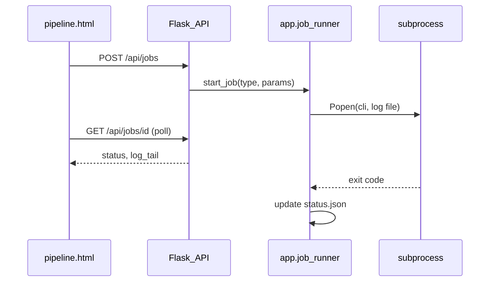

# Flask Pipeline：网页一键跑全流程

## 已确认需求

| 项 | 决定 |
|----|------|
| 范围 | 四步齐全：Crawl、Enrich、NLP、Generate brief |
| 执行 | `subprocess` + `data/jobs/<job_id>/status.json` + `log.txt`，前端轮询 |
| 并发 | 全局同时仅 1 个 running 任务 |
| Track | **网页文本输入**；须存在 [`config/{track}_keywords.yaml`](e:\Project4\jd_drissionpage_new\config) |
| Enrich | 提供 **limit** 数字框（空 = 不限制，对应 CLI 不传 `--limit`） |
| Brief | **必选** 多个 track（UI 用基于 config 发现的多选 checkbox）；成功后 **302/前端跳转** `/brief/<id>` |
| 环境 | 本机 `127.0.0.1`，无鉴权；子进程用 **`sys.executable`**（与 `run_dashboard.py` 同一解释器） |

## 架构

**新模块** [`app/job_runner.py`](e:\Project4\jd_drissionpage_new\app\job_runner.py)（名称可微调）：

- `discover_tracks()` → `config/*_keywords.yaml` → `["dse", "ielts_ai", ...]`
- `validate_track(track)` → 文件存在且名称合法（`^[a-z0-9_]+$`）
- `check_chromium(address)` → TCP 探测 `.env` 的 `CHROMIUM_ADDRESS`（默认 `127.0.0.1:9527`）
- `get_active_job()` / `start_job(job_type, **params)` / `poll_job(job_id)`
- 子进程命令（`cwd=ROOT`，`stdout+stderr` → `log.txt`）：
  - `crawl`: `[sys.executable, "-m", "crawler.xhs_crawler", "--track", track]`
  - `enrich`: `... xhs_enrich --track track` + 可选 `--limit N`
  - `nlp`: `... src.nlp.process --track track`（track 可为 `all` 或具体 id）
  - `brief`: `[sys.executable, "scripts/generate_brief.py", "--tracks", *tracks]`；成功后将 **最新** `docs/briefs/index.json` 首条 `id` 写入 `status.json` 的 `result.brief_id` 供跳转

**锁**：`data/jobs/_active.json` 存当前 `job_id`；`start_job` 时若存在 `status=running` 则返回 409；子进程结束（`wait` 在后台线程）后清除锁并写 `status=success|failed`、`exit_code`。

**目录**：`data/jobs/<job_id>/`（`status.json`, `log.txt`）；可选 `data/jobs/history` 列表 API 返回最近 N 条。

## 必须先改 crawler 以支持「任意 track」

当前 [`crawler/xhs_crawler.py`](e:\Project4\jd_drissionpage_new\crawler\xhs_crawler.py) 的 `load_config` 与 CLI `--track choices=("dse","ielts_ai")` 写死；[`xhs_enrich.py`](e:\Project4\jd_drissionpage_new\crawler\xhs_enrich.py) 复用同一 `load_config`。

- 将 `load_config(track)` 改为与 [`src/nlp/process.py`](e:\Project4\jd_drissionpage_new\src\nlp\process.py) 一致：`CONFIG / f"{track}_keywords.yaml"`，不存在则 `FileNotFoundError`。
- CLI `--track` 改为 **字符串参数**（去掉 `choices`），由 `validate_track` 在 Web 层与 CLI 层共用逻辑（可在 `crawler` 包内小函数 `resolve_track_config(track)`）。

## Flask 路由与 UI

### API（[`app/__init__.py`](e:\Project4\jd_drissionpage_new\app\__init__.py) 或 [`app/routes/pipeline.py`](e:\Project4\jd_drissionpage_new\app\routes\pipeline.py) Blueprint）

| Method | Path | 作用 |
|--------|------|------|
| GET | `/pipeline` | 渲染 Pipeline 页 |
| GET | `/api/pipeline/tracks` | 返回 `discover_tracks()`（供 Brief 多选 + 提示可用 config） |
| GET | `/api/pipeline/chromium-status` | 返回端口是否可达 |
| POST | `/api/jobs` | body: `{ "type": "crawl|enrich|nlp|brief", "track": "...", "limit": null, "tracks": ["dse"] }` |
| GET | `/api/jobs/<job_id>` | `{ status, log_tail, exit_code, result?, error? }` |
| GET | `/api/jobs/active` | 当前 running 或 null |

### 模板 [`app/templates/pipeline.html`](e:\Project4\jd_drissionpage_new\app\templates\pipeline.html)

- 继承 [`base.html`](e:\Project4\jd_drissionpage_new\app\templates\base.html)，侧栏新增 **Pipeline**（`active_nav=pipeline`）。
- 英文 UI（与 Policy 一致）。
- **Chrome 状态条**：加载时调用 `chromium-status`；不可达时禁用 Crawl/Enrich 并显示 README 前置步骤。
- **四张操作卡**：
  1. Crawl — track 文本框 + Run
  2. Enrich — track + limit（number, optional）+ Run
  3. NLP — track 文本框（提示可填 `all`）+ Run
  4. Brief — 多选 tracks（checkbox 来自 API）+ Run
- **任务面板**：当前 job id、状态、日志尾部（`pre` 自动滚动）、失败时显示 exit code。
- [`app/static/js/pipeline.js`](e:\Project4\jd_drissionpage_new\app\static\js\pipeline.js)：提交 POST → 每 2s 轮询 GET → `success` 且 `type=brief` 时 `window.location = /brief/{brief_id}`；`nlp`/`crawl`/`enrich` 成功显示「Refresh Overview/Figures」链接。

### 样式

- 在 [`app/static/css/style.css`](e:\Project4\jd_drissionpage_new\app\static\css\style.css) 增加 `.pipeline-card`、`.job-log`、`.status-badge` 等，复用现有深色主题。

## Brief 跳转细节

- `generate_brief.py` 已在成功后更新 [`docs/briefs/index.json`](e:\Project4\jd_drissionpage_new\docs\briefs\index.json)。
- Job 线程在 `returncode==0` 时读取 index，`result: { "brief_id": "<id>" }`。
- 若 API 失败但文件已写入，仍尝试读 index 首条作为 fallback。

## 文档与架构图

- [`README_XHS.md`](e:\Project4\jd_drissionpage_new\README_XHS.md)：主流程改为「启动 `run_dashboard.py` → Pipeline 页操作」；保留 CLI 等价命令作附录。
- [`docs/architecture.drawio`](e:\Project4\jd_drissionpage_new\docs\architecture.drawio)：Flask 增加 `/pipeline`、`data/jobs`、subprocess 箭头。

## 验收清单

1. 仅启动 `python run_dashboard.py`，在 `/pipeline` 可启动四类任务之一；第二个任务返回 busy。
2. 输入不存在 track → 400 + 明确错误。
3. Chrome 未开 → Crawl/Enrich 按钮禁用或 POST 返回说明。
4. Enrich 填 `limit=5` 仅处理 5 条（日志可见）。
5. NLP 成功后 `metrics.json` 时间戳更新；Overview 刷新可见。
6. Brief 多选 tracks 成功后浏览器进入 `/brief/<new_id>`。
7. CLI `python -m crawler.xhs_crawler --track dse` 仍可用（回归）。

## 实现顺序（Agent 建议）

1. 统一 `load_config` + CLI track 字符串化  
2. `job_runner.py` + `data/jobs` 约定 + API  
3. `pipeline.html` + `pipeline.js` + CSS + 侧栏  
4. README + drawio  
