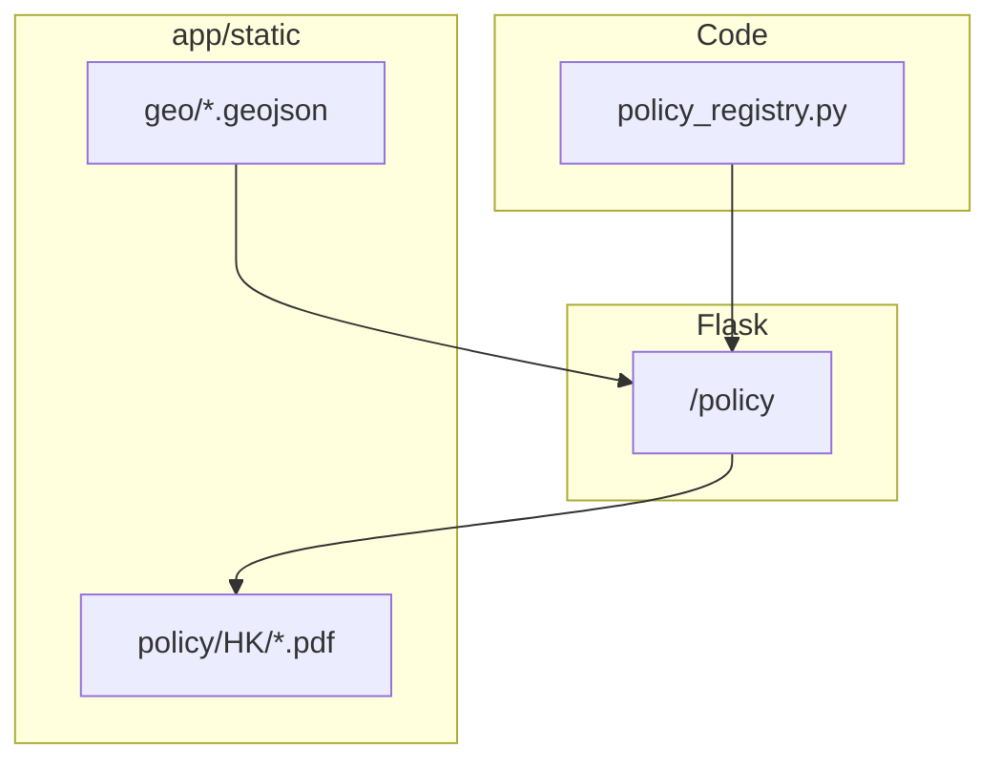

# Policy 页：内地/港澳台地图与 HK PDF 原型

## 目标行为（与已定共识对齐）

- **侧栏**：现有 [`app/templates/base.html`](e:\Project4\jd_drissionpage_new\app\templates\base.html) 增加第四链 **Policy**，路由 **`GET /policy`**，`active_nav='policy'`。
- **选项 B**：页面顶部 **National / mainland aggregate** 区块为 **Coming soon** 英文说明；**香港 PDF 仅通过地图选择 HK 后展示**。
- **地图**：可点击 **矢量省界**（约 34 个省级单位 **+** HK / MO / TW 显示）；**仅有内容的区域可点**——原型阶段 **仅 HK**；其余省份及 **MO、TW** **灰色且不可点**。
- **选中区域后**：**隐藏** National 区块，**仅显示** 该区域面板（英文）：免责声明、`Last loaded`（**选项 A**：服务端生成的当前请求 UTC 时间，文案用 *Last loaded*，避免误读为政策更新）、**Refresh** 按钮（`location.reload()`）。
- **PDF**：四份文件放入 **`app/static/policy/HK/`**（实现时把你已放进项目的 PDF **移动/复制**到此路径）；列表项 `target="_blank"` 指向 **`/static/policy/HK/<file>.pdf`**（不使用 `file://`）。
- **元数据展示**：每条文档显示 **Issuing body**、**Reference**（无则 `N/A`）、**Source URL**（链接）、**Excerpt date**；正文仍以列表标题为主。
- **搜索**：仅 **英文**，对当前所选区域下的 **文档标题** 做客户端过滤（输入框 + 过滤列表）；未选区域时可提示先选择 HK，或禁用搜索（实现时二选一，推荐：**仅在有选中区域时启用**，逻辑最简单）。
- **无清单文件**：不新增 YAML/JSON；使用 **`app/policy_registry.py`**（或同级模块）内嵌 **Python 列表/字典**，键为 **文件名** 或与静态文件名一致，字段包含 `title_en`、`issuer`、`reference`、`source_url`、`excerpt_date`。**四条记录**与四个 PDF 一一对应；后续可加 mainland 时再扩展。

## 实现要点

### 1. 数据与静态文件

| 内容 | 位置 |
|------|------|
| PDF | [`app/static/policy/HK/`](e:\Project4\jd_drissionpage_new\app\static\policy\HK\) |
| 文档元数据 | [`app/policy_registry.py`](e:\Project4\jd_drissionpage_new\app\policy_registry.py)（仅代码，非独立「清单文件」） |

加载逻辑：`REGION_DOCUMENTS = {'HK': [...]}`；路由把 registry + `last_loaded_utc` 传入模板。

### 2. 地图技术选型（矢量 + 灰显 + 点击）

- **推荐**：页面通过 **CDN** 引入 **ECharts**（不传 npm、不写构建），使用 **GeoJSON**（标准中国区划，含港澳台的 commonly used 呈现方式）注册为 map；series `emphasis`/`itemStyle` 控制 **不可选区域灰色**、`selectable: false` 或透明度区分。
- GeoJSON 放入例如 [`app/static/geo/china_regions.geojson`](e:\Project4\jd_drissionpage_new\app\static\geo\china_regions.geojson)（实现时选用可信开源行政区数据源，名称与 registry 中的 region code **HK/MO/TW/各省简称或 adcode** 对齐）。
- **HK** 对应 region 使用 **可点击 + 高亮**；点击后通过前端 JS 设置 `selectedRegion`，刷新下方面板 DOM（或小块模板由 Jinja 预渲染两套：`national_panel` / `region_panel`，JS 仅切换 `hidden`）。

### 3. 模板与脚本

- 新建 [`app/templates/policy.html`](e:\Project4\jd_drissionpage_new\app\templates\policy.html)：`extends base.html`，英文标题与说明；地图容器 `#policy-map`；`#region-content` 挂载 HK 文档列表（URL 用 Flask `url_for('static', ...)` 生成）；搜索框 `#policy-search`。
- 新建 [`app/static/js/policy_map.js`](e:\Project4\jd_drissionpage_new\app\static\js\policy_map.js)：初始化 ECharts、绑定点击、过滤列表、Refresh 按钮。
- 扩展 [`app/static/css/style.css`](e:\Project4\jd_drissionpage_new\app\static\css\style.css)：地图高度、免责声明样式、Coming soon 区块。

### 4. Flask

- [`app/__init__.py`](e:\Project4\jd_drissionpage_new\app\__init__.py)：新增 `policy()` 视图；`from app.policy_registry import REGION_DOCUMENTS`（或等价）；将 `documents_by_region`、`last_loaded_utc` ISO 字符串传入模板。

### 5. 文档与架构图

- [`README_XHS.md`](e:\Project4\jd_drissionpage_new\README_XHS.md)：增加 `/policy` 一行说明与 PDF 放置路径、`policy_registry.py` 维护方式。
- [`docs/architecture.drawio`](e:\Project4\jd_drissionpage_new\docs\architecture.drawio)：Flask 节点补充 **`/policy`** 与静态 `policy/`、`geo/`。

## 风险与边界

- **PDF 物理文件**：当前 workspace 未检出 `.pdf`；实现第一步需在仓库中 **定位你放置的四个文件** 并同步命名与 `policy_registry.py` 一致。
- **地图数据源**：需选用合规、可再分发的 GeoJSON；省级代码与 ECharts `nameMap`/adcode 需调试一致。
- **英文搜索**：仅匹配 `title_en`；后续若加中文字段再扩展 tokenizer。

## 验收

- 打开 `/policy`：英文界面、National Coming soon、免责声明、Last loaded UTC、Refresh 重载。
- 地图：绝大多数区域灰且不可点；**HK 可点**；点击后仅显示 HK 文档列表；每条含元数据；标题在新标签打开对应 PDF。
- 搜索框：英文子串过滤 HK 列表标题。
