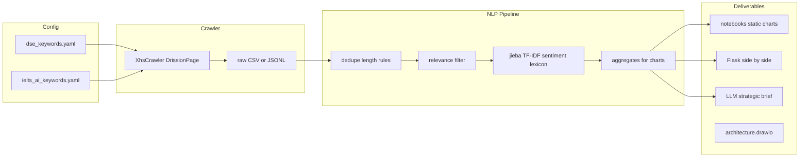

# 小红书 DSE / AI 备考竞品分析流水线（本学期交付）

## 范围与成功标准

- **唯一信源**：小红书（不做京东新爬取；[`jd_new.py`](e:\Project4\jd_drissionpage_new\jd_new.py) 仅作「浏览器自动化 + 写 CSV」的参考）。
- **双分析赛道**：同一套爬虫逻辑 + 两份关键词配置（DSE；IELTS Ready / AI 写作口语评分等窄词，贴合「AI 辅助备考」竞品）。
- **样本量**：以 **≤5000 条/赛道** 为上限目标；若规则过滤后高质量样本为 **2000–3000**，在报告中标明筛选标准与时间窗即可。
- **时间窗默认**：**最近 12 个月**（或固定起始日如 2024-01-01 至爬取日），若有效条数不足再延长，并在 README/报告中说明。
- **合规**：仅采集与课题相关的公开字段；**不存储**手机号、私信；可存点赞/收藏/评论数；用户标识在分析与展示中**哈希或打码**。

## 端到端数据流（实现时对照）

## 1. 项目结构与依赖

- 在仓库根目录新增 **`requirements.txt`**（或 `requirements-project.txt`）：固定版本列出 `DrissionPage`、`pandas`、`jieba`、`scikit-learn`、`matplotlib`/`seaborn`、`wordcloud`、`flask`、用于请求的 `httpx`/`requests`（若 LLM API）、`pyyaml`、`python-dotenv` 等。
- 建议目录示例（Agent 实施时按此落地）：
  - `config/dse_keywords.yaml`、`config/ielts_ai_keywords.yaml`（关键词列表、可选排除词、最小正文长度）。
  - `src/` 或 `crawler/`：`xhs_crawler.py`（入口可 `python -m crawler.xhs --track dse`）。
  - `data/raw/`：原始抓取；`data/processed/`：清洗后带 `track`、`valid`、`sentiment_coarse` 等列。
  - `notebooks/`：迁移/精简现有 [`visualization.ipynb`](e:\Project4\jd_drissionpage_new\visualization.ipynb) 逻辑到新数据 schema（或新建 `analysis_xhs.ipynb`，旧 JD notebook 可保留但不作为本学期主路径）。
  - `app/`：`flask` 应用，静态图或运行时读 `processed` 聚合结果 JSON。
  - `docs/architecture.drawio`：英文标注。
  - `scripts/generate_brief.py`（或 `src/brief.py`）：读聚合统计 + 少量代表性短语，调用商业 LLM API 生成 **简短** 简报（1–2 页结构）；API Key 用 **`.env`**，不入库。

## 2. 小红书爬虫（技术风险最高项）

- **复用思路**（来自 [`jd_new.py`](e:\Project4\jd_drissionpage_new\jd_new.py)）：`ChromiumPage`、显式等待、`listen` 抓 XHR（若小红书搜索/笔记列表走接口）、滚动加载、随机间隔、失败重试。
- **须 Agent 阶段实测**：小红书 Web 的搜索 URL、列表 DOM、是否需登录 Cookie、反爬频率；计划采用 **保守频率 + 可配置最大条数 + 断点续爬**（按页或按游标存进度）。
- **输出字段**（建议）：`track`（dse / ielts_ai）、`note_id` 或 URL、`title`、`desc`（正文）、`publish_time`（若可得）、`likes`、`collects`、`comments_count`、抓取时间；**不要**私信/手机号。
- **去重**：按 `note_id` 或规范化 URL 去重后再进入清洗。

## 3. 清洗与「有效帖」判定

- **基础**：去空、去重、最小长度（如 ≥15–30 字可配置）。
- **相关性**：标题或正文至少命中该 `track` 对应关键词之一；可选 **黑名单**（强广告模板词）迭代。
- **统计**：输出 `raw_count` → `valid_count`，写入报告与 Flask 数据源，避免「无效数据充数」。

## 4. 中文 NLP 与分析（本学期不依赖 LLM 批量标注）

- **分词**：`jieba` + 项目内 **停用词表**（通用 + 小红书噪声词）+ **领域用户词典**（DSE、科目、IELTS Ready 等产品名）。
- **关键词 / 词云**：优先 **TF-IDF**（缓解「的、非常」等高频无信息词）；词云用过滤后的 top terms（与现有 [`visualization.ipynb`](e:\Project4\jd_drissionpage_new\visualization.ipynb) 中 WordCloud 用法对齐，但换数据源与词表）。
- **粗粒度情感**（三档）：**焦虑压力 / 中性信息 / 正面期待**——用**小规模情感词典**（可中英文焦虑词）+ 简单规则；输出分布直方图或条形图（替代原「基于星级」的情感得分逻辑）。
- **趋势**（若时间字段可靠）：按周或月聚合帖量与情感比例。
- **可选增强**（时间允许）：`sklearn` 的 LDA 或轻量主题数固定为 3–5，仅作附录，避免喧宾夺主。

## 5. 可视化与 Flask 交付

- **静态交付**：notebook 导出图表到 `Visualization/` 或 `static/figures/`（情感分布、双赛道词云、可选趋势图），满足课程「EduTech Data Visualization Suite」。
- **Flask**：单页或双栏 **并排对比**（DSE vs IELTS AI 赛道）：同一套图表组件，数据源为 `processed` 汇总 JSON（预计算，避免演示时跑全量 NLP）。样式简洁即可。

## 6. LLM 战略简报（短、可控成本）

- **输入**：各赛道有效样本量、TF-IDF Top 词、粗粒度情感比例、可选 3–5 条脱敏短句（非全量原文）。
- **输出**：英文或中英（按 Master Mock 需要；章程合作为港方，**简报可英文化**，与 draw.io 一致）。
- **提示词**：固定小节（Executive summary、Trends、Risks、Recommendations for mainland entry）；**不**把数万字原文塞进 context。

## 7. 架构图（draw.io）

- 节点：`XHS Crawler`、`Raw Storage`、`Cleaning and Validation`、`Chinese NLP`、`Aggregated Metrics`、`Notebook Charts`、`Flask Dashboard`、`LLM Brief Generator`；旁注 **Compliance: public fields only, PIPL-aware minimization**。
- 文件：[`docs/architecture.drawio`](docs/architecture.drawio)（新建）。

## 8. 与现有文件的衔接

- **保留**：[`data_processing.ipynb`](e:\Project4\jd_drissionpage_new\data_processing.ipynb)、[`visualization.ipynb`](e:\Project4\jd_drissionpage_new\visualization.ipynb)、[`jd.csv`](e:\Project4\jd_drissionpage_new\jd.csv) 作为历史作业参考，**不删除**除非你们小组决定精简仓库。
- **主路径**：新数据与新 notebook/脚本；课程报告说明「本学期数据为小红书，京东代码仅为前期原型」。

## 9. 风险与缓解

| 风险 | 缓解 |
|------|------|
| 小红书页面/接口变更 | 元素与接口写在单独模块，便于改选择器；优先可维护的少量入口 URL |
| 登录或风控 | 低频率、分次爬取；必要时文档说明需手动登录后使用 Cookie（合规前提下） |
| 有效样本不足 5000 | 已接受 2000–3000；放宽时间窗或微调关键词（仍保持「贴 AI 产品」竞品口径） |
| LLM 费用 | 简报仅用聚合特征 + 短引句；限 `max_tokens` |
