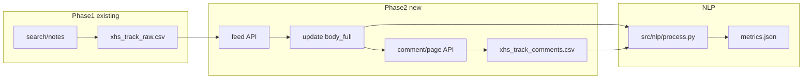

# 小红书爬虫升级：正文（feed）+ 评论（comment/page）与下游一致化

## 目标与约束

- **正文**：监听 `https://edith.xiaohongshu.com/api/sns/web/v1/feed`，从 `data.items[0].note_card.desc` 取全文（与你在 Network 中验证一致）。
- **评论**：监听 `https://edith.xiaohongshu.com/api/sns/web/v2/comment/page`，解析 `data.comments`；**选项 A**：最多 **50 条一级评论**；每条一级下的 **`sub_comments` 全部抓取**（不计入 50）。
- **翻页**：用响应里的 `data.cursor` 继续请求直到凑满 50 条一级或 `comments` 为空/`has_more` 类字段为假（以实际 JSON 为准）。
- **登录**：评论接口需会话；沿用 **已登录的 Chromium + `CHROMIUM_ADDRESS`**（与 [`README_XHS.md`](e:\Project4\jd_drissionpage_new\README_XHS.md) 一致），不在仓库写死 Cookie/`xsec_token`。
- **速度**：笔记间 `sleep` 可配置（如 `config/*.yaml` 增加 `enrich_delay_sec`）。

## 架构：两阶段流水线

---

## 1. 数据模型（避免前后矛盾）

### 1.1 扩展主表 [`data/raw/xhs_{track}_raw.csv`](e:\Project4\jd_drissionpage_new\data\raw\xhs_dse_raw.csv)

在现有 [`FIELDNAMES`](e:\Project4\jd_drissionpage_new\crawler\xhs_crawler.py)（约 162–175 行）基础上增加列，建议：

| 新列 | 含义 |
|------|------|
| `body_full` | **feed 返回的完整正文**；搜索阶段可为空，enrich 后写入 |
| `enrich_status` | 如 `pending` / `ok` / `fail`（便于断点续跑） |
| `enrich_error` | 失败时短原因（可选） |
| `enriched_at` | 完成 enrich 的时间 |

语义约定：

- **`desc`**：保留为「搜索列表里的摘要」，与历史数据兼容；**NLP 优先用 `body_full`**。
- 搜索阶段写入逻辑不变；**未跑 enrich 前**下游仍可用 `title+desc`（与当前行为一致）。

### 1.2 新增评论侧表 `data/raw/xhs_{track}_comments.csv`（一行一条评论或回复）

建议列：

- `track`, `note_id`, `comment_id`, `parent_comment_id`（顶级为空或固定标记）, `depth`（0=一级，1=回复）, `content`, `like_count`, `author_masked`, `create_time`（若有）, `crawled_at`

**不在此表存**手机号、私信；`nickname` 仅哈希（与主表 `author_masked` 规则一致）。

---

## 2. 爬虫实现要点（新模块 + 复用现有）

- **新脚本**（建议 [`crawler/xhs_enrich.py`](e:\Project4\jd_drissionpage_new\crawler\xhs_enrich.py) 或 `enrich` 子命令）：读主表 CSV，对 `enrich_status != ok`（或 `body_full` 空）的行逐条处理。
- **DrissionPage**：`listen.start` 同时匹配子串 **`sns/web/v1/feed`** 与 **`comment/page`**（或分别两次 `get`：先打开详情拿 feed，再滚动/触发评论区拿 comment；以实际页面能否一次加载为准）。
- **详情 URL**：使用现有 `url` 列（`explore/{note_id}`）；若需 `xsec_token`，从**当前页地址栏 Query** 或 **feed 请求 URL** 中解析，不写死。
- **feed 解析**：与搜索共用思路——`extract_note_from_item` 可抽 **公共函数** 到 [`crawler/xhs_crawler.py`](e:\Project4\jd_drissionpage_new\crawler\xhs_crawler.py) 或 `crawler/xhs_parse.py`，从 `items[0].note_card` 取 `desc` 写入 `body_full`。
- **评论解析**：遍历 `data.comments`；计数仅 **一级** 达 50 即停止继续请求 **主列表**下一页；每条一级的 `sub_comments` **全部**落表。
- **断点**：除主表状态外，可用 `data/raw/.enrich_progress_{track}.json` 记录最后成功 `note_id`。
- **CLI**：`python -m crawler.xhs_enrich --track dse [--limit N] [--start-row i]`，便于分批跑。

---

## 3. NLP：[`src/nlp/process.py`](e:\Project4\jd_drissionpage_new\src\nlp\process.py)

- **`text_full` 定义（统一口径）**：

  `text_full = title + " " + coalesce(body_full, desc) + " " + comments_blob`

  其中 `comments_blob` 为该 `note_id` 在侧表中**所有** `content` 拼接（空格分隔）；若侧表无数据则仅正文。

- **`is_valid_row`**：有效性判断里的 `blob` 改为基于 `title + body_full（或 desc）`；`min_text_length` 仍读 YAML；避免因仅评论很长而误判时，可要求「正文+标题」过短则 invalid（具体阈值与课程一致即可）。

- **TF-IDF / 词云 / 粗粒度情感**：对上述 **`text_full`** 跑现有管线；保证与「含评论」语义一致。

- **`metrics.json` 扩展**（供 Flask / 简报）：

  - `comment_rows_total`：该 track 评论行数  
  - `avg_comments_per_note`：有评论的笔记均值（可选）  
  - 可选：`tfidf_top_post_only`（仅用 `title+body`）与 `tfidf_top_merged` 二选一展示——若时间紧，**只保留合并版 `tfidf_top`** 并在文档中注明「含评论文本」。

---

## 4. 可视化与 Flask

- **[`app/templates/dashboard.html`](e:\Project4\jd_drissionpage_new\app\templates\dashboard.html)**：在现有 raw/valid、情感、TF-IDF 下增加一小节：**评论条数统计**（读 `metrics.json` 新字段）。
- **[`notebooks/analysis_xhs.ipynb`](e:\Project4\jd_drissionpage_new\notebooks\analysis_xhs.ipynb)**：说明 `text_full` 含评论；可选增加「评论条数直方图」单元（从侧表聚合）。

---

## 5. 文档与简报

- 更新 [`docs/DATA_SCHEMA.md`](e:\Project4\jd_drissionpage_new\docs\DATA_SCHEMA.md)：主表新列 + 评论侧表 + `text_full` 公式。
- 更新 [`README_XHS.md`](e:\Project4\jd_drissionpage_new\README_XHS.md)：流程改为 **`search` → `enrich` → `process` → `run_dashboard`**。
- [`scripts/generate_brief.py`](e:\Project4\jd_drissionpage_new\scripts\generate_brief.py)：提示词中可一句说明「metrics 含评论聚合」，无需改 API 形态（仍读 `metrics.json`）。

---

## 6. 风险与测试

- **接口变更**：`feed`/`comment/page` 字段路径封装在单独解析函数内，便于改一处。
- **大 CSV**：评论侧表可能很大；处理时用 `pandas` 按 `note_id` `groupby` 聚合拼接，注意内存（必要时 `chunksize` 或只读需要的列）。
- **回归**：用少量行跑通 `enrich` → `process` → Flask，确认 `metrics.json` 与页面无 Key 错误。

---

## 7. 不在本计划内（避免范围膨胀）

- 不实现子评论分页（`sub_comment_cursor`）除非课程明确要求且时间允许；若一级下回复极多，可在文档中说明「已抓接口返回的全部 sub_comments」。
